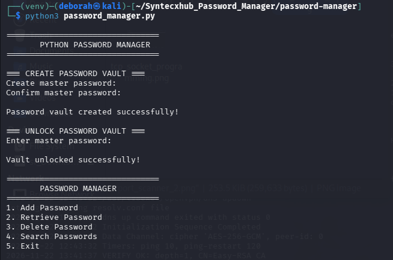
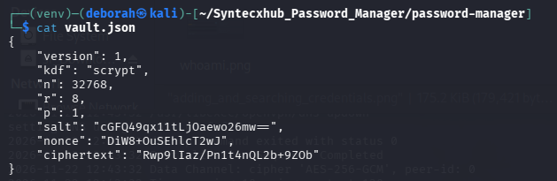
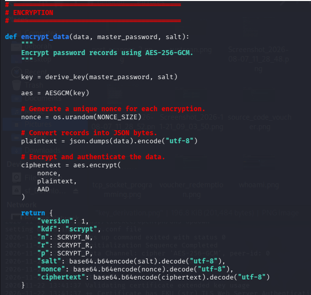

# Password Manager

**A Python-based Password Manager | Cybersecurity Project**

A command-line password manager built with Python that securely stores credentials in an encrypted local vault.

This project gave me an opportunity to apply Python programming and explore practical concepts in encryption, password security and secure data storage.

## Features

- **Master Password Authentication:** Protects access to the password vault with a master password.
- **AES-256-GCM Encryption:** Encrypts stored credentials and provides data integrity and authentication.
- **Scrypt Key Derivation:** Derives an encryption key from the master password.
- **Random Salt and Nonce:** Uses randomly generated values during key derivation and encryption.
- **Add Credentials:** Store website names, usernames, and passwords.
- **Retrieve Credentials:** View saved login details.
- **Search Credentials:** Search for stored accounts.
- **Delete Credentials:** Remove saved entries.
- **Encrypted Local Storage:** Stores vault data in a JSON file containing encrypted information rather than readable credentials.

## Technologies Used

- Python 3
- Cryptography library
- AES-256-GCM
- Scrypt
- JSON
- Kali Linux

## Project Structure Info

The encrypted `vault.json` file is generated locally when the application creates a vault. It is excluded from Git tracking to prevent sensitive data from being uploaded to GitHub.

## Installation and Setup

### 1. Create a Virtual Environment

```bash
python3 -m venv venv
```

### 2. Activate the Virtual Environment

```bash
source venv/bin/activate
```

### 3. Install Dependencies

```bash
pip install -r requirements.txt
```

### 4. Run the Application

```bash
python3 password_manager.py
```

## How It Works

1. When the application runs for the first time, it prompts the user to create a master password.
2. A random salt is generated and used with Scrypt to derive a 256-bit encryption key.
3. The application uses AES-256-GCM to encrypt the vault contents.
4. Encrypted data is saved locally in `vault.json`.
5. On subsequent runs, the user must enter the correct master password to unlock the vault.
6. Once authenticated, the user can add, retrieve, search, and delete credentials.

## Screenshots

### 1. Application Interface

Shows the main command-line interface and available password management options.



### 2. Master Password Setup

Shows the initial master password creation process.


### 3. Adding Credentials

Demonstrates adding a sample website, username, and password to the vault.


### 4. Encrypted Vault Storage

Shows the encrypted JSON vault and demonstrates how stored information is protected rather than saved as readable credentials.



### 5. Encryption Implementation

Highlights the Python functions responsible for key derivation, encryption, and decryption.





## Security Concepts Applied

| Concept | Purpose |
|---|---|
| AES-256-GCM | Encrypts and authenticates stored data |
| Scrypt | Derives an encryption key from the master password |
| Random Salt | Makes key derivation unique for each vault |
| Random Nonce | Ensures encryption uses a fresh nonce |
| Base64 Encoding | Represents binary encryption data in JSON |
| `.gitignore` | Prevents the local vault and virtual environment from being tracked by Git |

## What I Learned

Through this project, I gained practical experience with:

- Implementing encryption and decryption using Python.
- Understanding symmetric encryption and authenticated encryption.
- Using password-based key derivation.
- Handling sensitive information in a local application.
- Managing Python dependencies and virtual environments.
- Using Git and GitHub to manage and document a cybersecurity project.

## Future Improvements

- Add automatic vault locking after inactivity.
- Implement password strength checking.
- Add password generation functionality.
- Improve input validation and error handling.
- Add automated unit tests.
- Introduce a graphical user interface.

## Disclaimer

This project was developed for educational purposes as part of a cybersecurity internship. It is a learning project and has not been independently audited or tested for production use.
Avoid storing real or sensitive credentials in this application.
