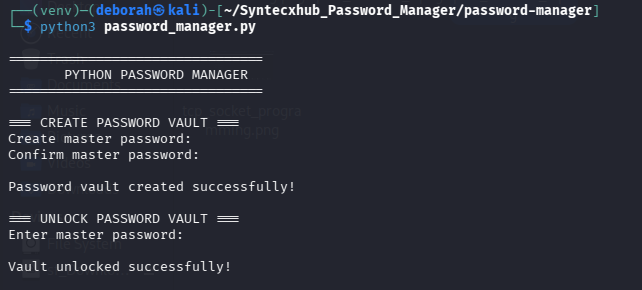
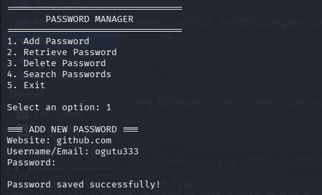
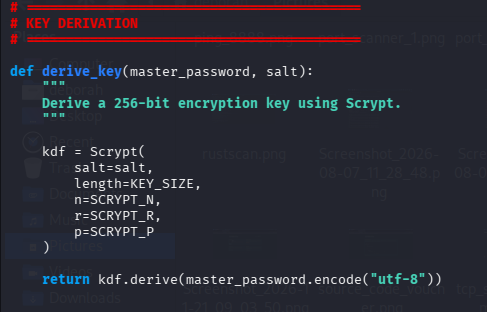
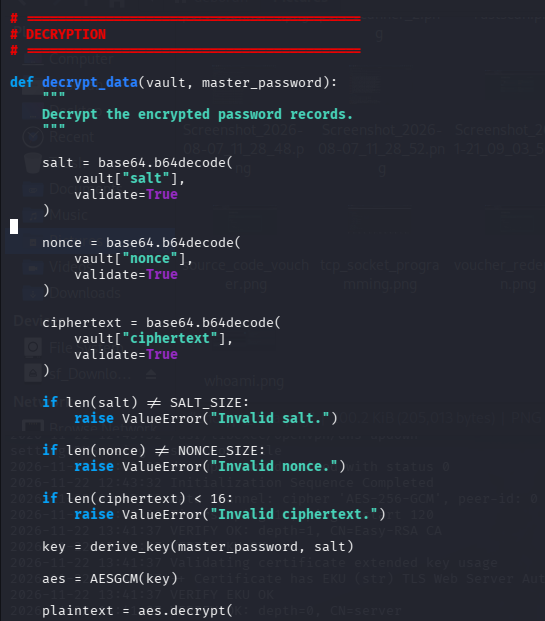
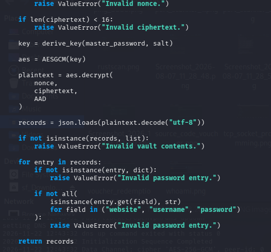

# Password Manager

**A Python-based Password Manager | Cybersecurity Project**

A command-line password manager built with Python that securely stores credentials in an encrypted local vault.

This project gave me an opportunity to apply Python programming and explore practical concepts in encryption, password security and secure data storage.

## Features

- **Master Password Authentication:** Protects access to the password vault with a master password.
- **AES-256-GCM Encryption:** Encrypts stored credentials and provides data integrity and authentication.
- **Scrypt Key Derivation:** Derives an encryption key from the master password.
- **Random Salt and Nonce:** Uses randomly generated values during key derivation and encryption.
- **Add Credentials:** Store website names, usernames, and passwords.
- **Retrieve Credentials:** View saved login details.
- **Search Credentials:** Search for stored accounts.
- **Delete Credentials:** Remove saved entries.
- **Encrypted Local Storage:** Stores vault data in a JSON file containing encrypted information rather than readable credentials.

## Technologies Used

- Python 3
- Cryptography library
- AES-256-GCM
- Scrypt
- JSON
- Kali Linux

## Project Structure Info

The encrypted `vault.json` file is generated locally when the application creates a vault. It is excluded from Git tracking to prevent sensitive data from being uploaded to GitHub.

## Installation and Setup

### 1. Create a Virtual Environment

```bash
python3 -m venv venv
```

### 2. Activate the Virtual Environment

```bash
source venv/bin/activate
```

### 3. Install Dependencies

```bash
pip install -r requirements.txt
```

### 4. Run the Application

```bash
python3 password_manager.py
```

## How It Works

1. When the application runs for the first time, it prompts the user to create a master password.
2. A random salt is generated and used with Scrypt to derive a 256-bit encryption key.
3. The application uses AES-256-GCM to encrypt the vault contents.
4. Encrypted data is saved locally in `vault.json`.
5. On subsequent runs, the user must enter the correct master password to unlock the vault.
6. Once authenticated, the user can add, retrieve, search, and delete credentials.

## Screenshots

### 1. Application Interface

Shows the main command-line interface and available password management options.


### 2. Master Password Setup

Shows the initial master password creation process.



### 3. Adding Credentials

Demonstrates adding a sample website, username, and password to the vault.



### 4. Encrypted Vault Storage

Shows the encrypted JSON vault and demonstrates how stored information is protected rather than saved as readable credentials.


### 5. Encryption Implementation

Highlights the Python functions responsible for key derivation, encryption, and decryption.






## Security Concepts Applied

| Concept | Purpose |
|---|---|
| AES-256-GCM | Encrypts and authenticates stored data |
| Scrypt | Derives an encryption key from the master password |
| Random Salt | Makes key derivation unique for each vault |
| Random Nonce | Ensures encryption uses a fresh nonce |
| Base64 Encoding | Represents binary encryption data in JSON |
| `.gitignore` | Prevents the local vault and virtual environment from being tracked by Git |

## Threat Model & Security Considerations

This password manager is designed to protect locally stored credentials against unauthorised access, particularly if the encrypted vault is copied or accessed without the master password.

### Threats Considered

| Threat | Security Consideration |
|---|---|
| Offline Brute-Force Attacks | Scrypt increases the computational cost of guessing the master password, making large-scale password guessing more expensive. However, weak master passwords remain vulnerable. |
| Vault Theft | AES-256-GCM encrypts stored credentials, so obtaining the vault file alone should not expose the plaintext passwords without the encryption key. |
| Data Tampering | AES-256-GCM provides authenticated encryption, allowing unauthorised modifications to encrypted vault data to be detected during decryption. |
| Credential Exposure in GitHub | `.gitignore` excludes the local vault file from version control, reducing the risk of accidentally publishing stored credentials. |

## Attacker Perspective

An attacker targeting this application might first attempt to obtain a copy of the local `vault.json` file and perform offline password guessing against the encrypted data. They could also target the host machine using keyloggers or malware to capture credentials when the vault is unlocked. To address these risks, I implemented Scrypt-based key derivation, AES-256-GCM authenticated encryption, and excluded the local vault from Git tracking. However, endpoint compromise remains outside the protection provided by the current implementation.

### Security Limitations

The current implementation does not protect against every attack:

- **Memory Scraping:** Malware with sufficient access to the system could potentially extract decrypted credentials or encryption keys from process memory.
- **Keyloggers:** Malicious software could capture the master password as it is entered.
- **Compromised Operating System:** An attacker with control of the host operating system could potentially access credentials after the vault is unlocked.
- **Vault Rollback:** An attacker could potentially replace the current vault with an older valid copy. The current implementation does not provide rollback detection.
- **Weak Master Passwords:** Scrypt increases the cost of offline password guessing but cannot compensate for a weak master password.

These limitations highlight the importance of protecting the host system alongside the encrypted vault.

## Future Improvements

- **Automatic Vault Locking:** Implement session timeouts to reduce the risk of unauthorised access when the application is left unattended.
- **Master Password Policy:** Introduce password strength validation to reduce the risk of weak master passwords and offline brute-force attacks.
- **Secure Password Generation:** Add cryptographically secure random password generation to help users create stronger credentials.
- **Input Validation & Error Handling:** Harden credential input fields against malformed input, unexpected data types and injection attempts.
- **Automated Security Testing:** Add unit tests for encryption, decryption, key derivation, authentication failures and tampered vault data.
- **Vault Integrity & Recovery:** Introduce secure backup handling and mechanisms to detect unauthorised vault rollback.
- **Secure Memory Handling:** Explore ways to minimise the exposure of decrypted credentials and sensitive key material in application memory.
- **Graphical User Interface:** Develop a GUI while maintaining the existing encryption and secure storage mechanisms.

## Disclaimer

This project was developed for educational purposes as part of a cybersecurity internship. It is a learning project and has not been independently audited or tested for production use.
Avoid storing real or sensitive credentials in this application.
